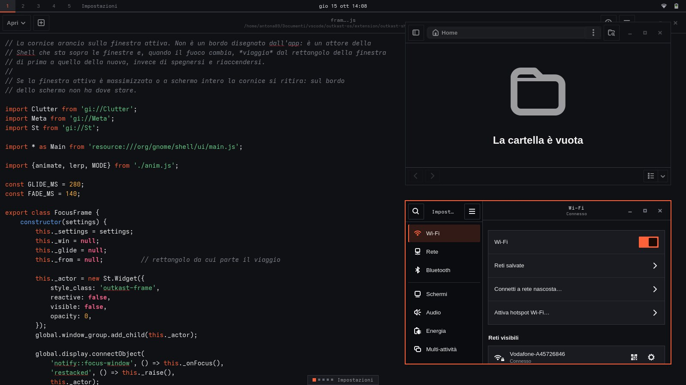
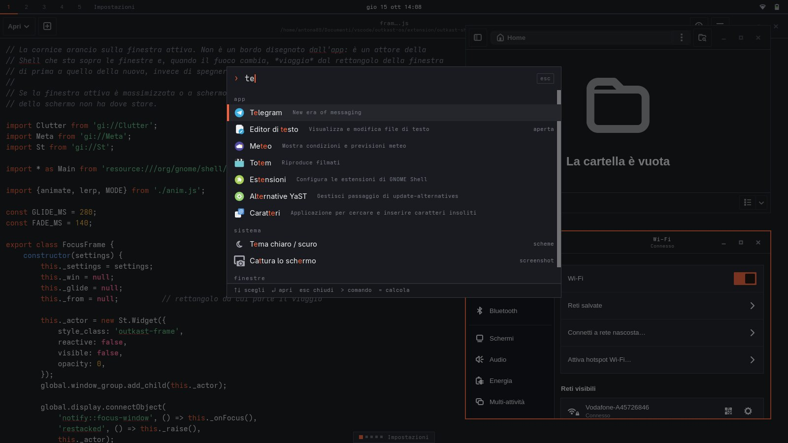
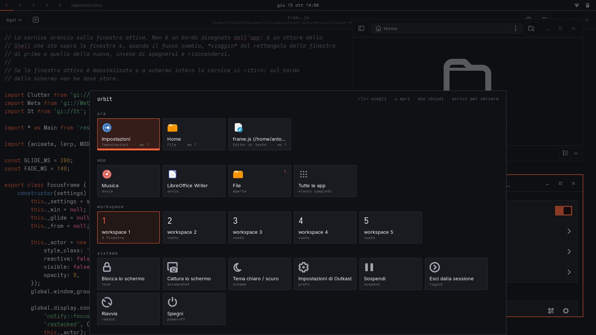
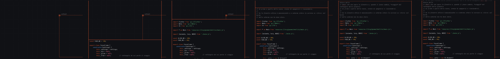
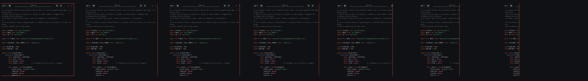
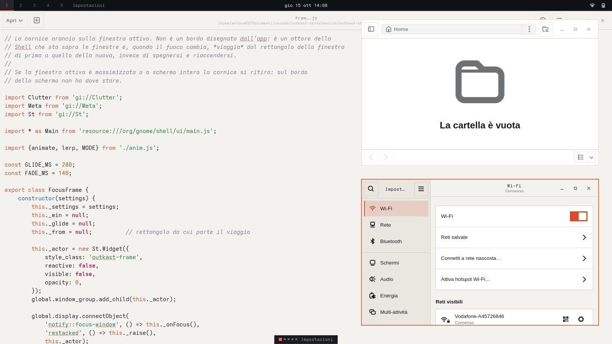
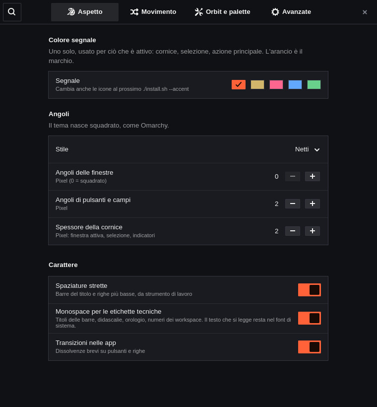

# Outkast OS

A **GNOME 50** desktop with [Omarchy](https://github.com/omacom/omarchy)'s grammar — flat, hairlines, keyboard first,
monospace where it means something — in the palette of [Outkast](https://github.com/Lwb89dev/outkast): one orange
signal (`#ff6238`) on midnight (`#101114`), or on warm paper in light mode. It has a number-first top bar, a command
palette instead of Activities, **Orbit** (Outkast's pull-up control surface, instead of a dock), and **windows that
move along the edges of the screen** with an orange frame that follows the active one.



| Command palette | Orbit |
|---|---|
|  |  |

> The images are real screenshots of a GNOME Shell 50 with Outkast OS installed, taken in the headless test bench
> (`tools/shell-test/`). Light mode is below.

> **Language:** the installer messages, the settings panel and the palette strings are currently in Italian only
> (the documentation is in English), like the sibling project Glassy.

## The idea in three lines

- **One signal.** Orange marks only what is *active*: the focus frame, the selected row, the primary action, the
  current workspace. Everything else is grey on grey, separated by 1px hairlines. No shadows, no blur.
- **Monospace as an accent, not a costume.** Titles of the header bars, captions, the clock, workspace numbers and
  key hints are monospace; the text you read is not. (Outkast itself reserves its monospace for "small
  identity/technical accents".)
- **Windows have an edge.** A window enters from the screen edge nearest to it and is cast out through it when you
  close it; minimizing withdraws it into the bar. See [Motion](#motion).
- **No dock, but Orbit.** Outkast has no persistent navigation bar: a small portal at the bottom edge opens a panel of
  tiles. Here it is the same gesture, in place of a dock. See [Orbit](#orbit).

## Installation

```bash
./install.sh
```

It does everything on its own: it shows what it is going to do, asks for confirmation, saves your original
settings, and installs

- the **Outkast** theme for GTK4/libadwaita, GTK3 and GNOME Shell (dark and light, following the system scheme);
- the **Tela** icons in the orange variant (by Vinceliuice, GPL-3.0): if a `Tela-orange/` folder sits next to
  `install.sh` it uses that, otherwise it downloads a pinned release from GitHub and verifies its SHA-256;
- the **Outkast** wallpapers (dark and light);
- the **Outkast Shell** extension (written for this project, in `extension/`): the bar, the palette, Orbit, the motion;
- a color scheme for **GtkSourceView** (Text Editor, Builder…) and a palette for **Ptyxis**; ready-made files for
  alacritty, kitty, foot and ghostty;
- desktop settings: fixed workspaces (5), `Super+1…5`, `Super+Return` (terminal), `Super+W` (close), window buttons on
  the right, hot corner off, clock with weekday and date;
- an **Outkast Settings** entry in the app menu.

No extension is downloaded from extensions.gnome.org: the extension loads the Shell stylesheet itself.

Then **log out and back in**: GNOME Shell cannot be restarted in place on Wayland, so the bar, palette and motion
only start at the next login.

> **Apps that are already open keep their old style.** GNOME apps read the theme when they start, and Nautilus
> stays in memory even with all windows closed: until you restart it (`nautilus -q`, or log out and in) it keeps the
> previous style. The installer offers to close it for you.

Requirements: GNOME Shell 50 (the extension declares compatibility with 50 only; the theme needs GNOME 45+), `gjs`,
`curl` or `wget`, `tar`, `xz`, `sha256sum` and `glib-compile-schemas`. The installer tells you what is missing.

### Options

```
./install.sh --accent gold          orange (default) gold rose blue green: the signal color
./install.sh --light                light scheme (default: dark)
./install.sh --workspaces 4         number of fixed workspaces (default 5)
./install.sh --dynamic-workspaces   keep GNOME's dynamic workspaces
./install.sh --no-extension         theme and icons only: no bar, palette or motion
./install.sh --no-keys              do not touch keyboard shortcuts
./install.sh --no-extras            no editor/terminal schemes
./install.sh --no-icons  --no-wallpaper  --no-flatpak
./install.sh --restart-apps         close Nautilus without asking
./install.sh --dry-run              show what it would do, change nothing
./install.sh -y                     no confirmation prompt
```

You can re-run it whenever you like (to update, to change the signal color): it duplicates nothing and keeps the
original backup. A color or scheme you chose in the settings panel is not overwritten unless you pass the option again.

### Heads-up: the layout changes

The bar and palette replace GNOME's layout, so the installer **disables** (without removing) extensions that do
similar things or fight over the same animations: Dash to Panel, Dash to Dock, ArcMenu, Start Menu, Ubuntu Dock,
Dash2Dock, **Glassy Desktop**, Magic Lamp, Compiz windows effect, Burn My Windows and Blur my Shell. It lists them
before proceeding. With `--no-extension` it touches nothing of the sort.

**Glassy and Outkast OS are two complete desktops: use one at a time.** If Glassy is installed, `./install.sh` says so
and turns its extension off, but for a clean switch run Glassy's `./uninstall.sh` first, and install/uninstall the two
one after the other (both manage `~/.config/gtk-*/gtk.css`).

## What the desktop is like

**Bar** — on the left the workspaces as numbers (`1 2 3 4 5`): the current one is orange with an underline that glides
to the next when you switch, occupied ones are brighter, empty ones are faint; then the name of the foreground app.
Scroll over the numbers to change workspace. The clock, quick settings and notifications are GNOME's, restyled flat.

**Palette** — `Super` (or `Super+A`) opens a command palette at the center of the screen, rising from the bottom edge.

| You type | You get |
|---|---|
| `te` | apps and windows matching (substring first, then letters in order); sections ordered by best match |
| `= 2*(3+4)` or just `2*(3+4)` | the result; `Enter` copies it |
| `> echo hi` | runs the command |
| (nothing) | open windows, most used apps, a few system actions |

Keys: `↑↓` / `Ctrl+P/N` / `Ctrl+J/K` choose, `Tab` advances, `Enter` opens (apps: `Shift+Enter` for a new window),
`Alt+1…9` activates the nth row, `Ctrl+U` clears, `Esc` closes. System actions: lock, screenshot, light/dark,
Outkast settings, suspend, log out, restart, power off.

### Orbit

Outkast's navigation is a small *portal* at the bottom of the screen that you tap or **pull up** to open *Orbit*, a
panel of tiles. Outkast OS keeps both, in place of a dock:

- **The portal** — a small tab at the bottom center: the workspaces as squares (the current one is orange and larger)
  and the name of the foreground app. Click it, drag it up, scroll up over it, or swipe up with three fingers.
  *Settings → Orbit and palette* lets it **hide itself** and be called back:

| Portal | Behaviour |
|---|---|
| Always visible | the default; it sits on top of whatever is at the bottom center |
| **Hide when a window covers it** | visible on a free desktop, it slips under the edge as soon as a window overlaps it and comes back when the window moves away |
| Always hide, show at the edge | out of sight until the pointer touches the bottom edge of the screen |
| Never visible | no tab at all: the shortcut and the swipe are all that is left |

  Whenever it is hidden, **moving the pointer to the bottom edge** brings it back up (and it goes down again a moment
  after you leave). *Open by hovering* goes one step further: **resting the pointer** on the portal, or on the bottom
  edge, for a moment opens Orbit itself, with no click (there is a short pause after closing, so it does not
  reopen under the pointer). The three-finger swipe and `Super+O` work in every mode.
- **The panel** — rises from the bottom edge with the same wipe and orange seam as a window, over a dim layer:

| Section | Tiles |
|---|---|
| `ora` | the open windows (the focused one has an orange border); `Enter` jumps to it, **middle click closes it** |
| `app` | your favorites (the apps in GNOME's dash), with a count of their windows, and **All apps**, a full grid with a back arrow like in the Outkast app |
| `workspace` | the workspaces and how many windows each one holds |
| `sistema` | lock, screenshot, light/dark, settings, suspend, log out, restart, power off |

Keys: `Super+O` toggles it (change it in the settings), arrows move, `Enter` opens, `Esc` closes (or goes back), and
**typing a letter hands over to the command palette** with that letter already typed.

**Three-finger swipe.** On a touchpad or a touchscreen, three fingers **up** pull Orbit up: the panel rises *following your
fingers*, with the same inertia and thresholds as GNOME's overview gesture, and completes or snaps back depending on how
far and how fast you went. Three fingers **down** close it. Orbit takes over the vertical three-finger gesture that
GNOME uses for the overview (the horizontal one, which switches workspaces, is untouched); turn it off in
*Settings → Orbit and palette* to give the overview gesture back.

**No Activities/Overview** — the Activities button, the hot corner, the three-finger gesture and the `Super` shortcut
no longer open GNOME's overview: `Super` opens the palette and three fingers up pull up Orbit. To get it back, turn off *Replace Activities with the
palette* in the settings, or run `./uninstall.sh`. (Quick settings, the calendar and notifications stay.)

**Keyboard** — `Super+1…5` switches workspace, `Super+Shift+1…5` sends the window there, `Super+Return` opens a
terminal, `Super+W` closes, `Super+F` toggles fullscreen, `Super+arrows` tile (GNOME's own).

### Motion

A window belongs to the screen edge nearest to it. It enters from that edge, it is cast out through it when it closes,
and it withdraws into the bar when minimized.

| Open (from the bottom) | Close (cast out through the left edge) |
|---|---|
|  |  |

*Frames recorded at 1/10 speed. A 2px orange seam rides the front of the wipe.*

- **Focus frame.** A 2px orange frame on the active window. When focus changes it *travels* from one window to the
  other instead of blinking off and on. It withdraws when the window is maximized or fullscreen.
- Everything is tunable (*Settings → Motion*), including the speed; switching it off gives GNOME's default
  animations back. The reasoning is in [docs/DESIGN.md](docs/DESIGN.md).

### Light mode



The Shell stays dark (like a menu bar over a dark wallpaper); applications follow the system scheme.

| Settings, in its own theme |
|---|
|  |

### Outkast Settings

A panel with four pages, opened from the **Outkast Settings** entry (app menu), from the palette or from Orbit
(*sistema → Impostazioni di Outkast*). The menu entry also works right after installing, before the first new login
(see [Troubleshooting](#troubleshooting)):

| Page | What it controls |
|---|---|
| **Appearance** | signal color; corners (sharp / slightly rounded / soft, or exact pixels); frame thickness; compact spacing; monospace accents; app transitions |
| **Motion** | window motion on/off, speed, the focus frame |
| **Orbit and palette** | Orbit on/off, three-finger swipe, portal visibility (always / hide when covered / hide always / never), open by hovering, shortcut; palette instead of Activities, dimming, app name in the bar |
| **Advanced** | close Nautilus to apply the theme, regenerate the theme, restore defaults |

The bar, palette and motion react immediately. *Appearance* changes regenerate the CSS: the Shell updates on the fly,
GNOME apps at their next launch.

### Editors and terminals

| Where | How |
|---|---|
| Text Editor, Builder… | scheme *Outkast* (`outkast` / `outkast-dark`), installed in `~/.local/share/gtksourceview-5/styles/`; the installer selects it in Text Editor |
| Ptyxis | palette *Outkast*, installed and selected |
| alacritty, kitty, foot, ghostty | `~/.local/share/themes/Outkast/extras/terminals/` — include the file from your config (the first line of each says how) |
| GNOME Console | its palette is not themable |

The ANSI colors are Outkast's semantic ones (error red, success green, gold, bookmark blue, like rose); the brand orange
is kept for cursor and selection.

### Tweaking from the command line

The extension's settings live in its own folder, so `gsettings` needs to be told where:

```bash
S="$HOME/.local/share/gnome-shell/extensions/outkast-shell@outkast-os/schemas"
gsettings --schemadir "$S" set org.gnome.shell.extensions.outkast-shell accent 'gold'        # orange gold rose blue green
gsettings --schemadir "$S" set org.gnome.shell.extensions.outkast-shell corner-radius 8      # 0–16
gsettings --schemadir "$S" set org.gnome.shell.extensions.outkast-shell motion-speed 150     # 5–250 (%)
gsettings --schemadir "$S" set org.gnome.shell.extensions.outkast-shell focus-frame false
gsettings --schemadir "$S" set org.gnome.shell.extensions.outkast-shell orbit-portal 'smart'  # always smart edge hidden
gsettings --schemadir "$S" set org.gnome.shell.extensions.outkast-shell orbit-hover-open true  # open Orbit by resting the pointer
gsettings --schemadir "$S" set org.gnome.shell.extensions.outkast-shell orbit-gesture false   # give the three-finger swipe back to GNOME
```

Changing a theme key (accent, radii, compact, mono…) regenerates the CSS only from the settings panel; from the command
line run `gjs -m tools/render-theme.js --settings-from "$HOME/.local/share/gnome-shell/extensions/outkast-shell@outkast-os"`
and then log out, or bump `theme-serial` to make the Shell reload.

## Uninstalling

```bash
./uninstall.sh
```

It puts every setting back to the value it had before (including the list of enabled extensions and your keyboard
shortcuts), restores any `~/.config/gtk-3.0/gtk.css` and `gtk-4.0/gtk.css` of yours, and removes only what the
installer created from scratch.

## How it is built

| Part | Where | Notes |
|---|---|---|
| Bar, palette, Orbit, motion, focus frame | `extension/outkast-shell@outkast-os/` | GNOME Shell extension (ESM). `bar.js` workspaces and app name, `launcher.js` + `calc.js` the palette, `portal.js` + `orbit.js` Orbit, `actions.js` the system actions both use, `motion.js` + `anim.js` the window motion, `frame.js` the focus frame, `lockdown.js` Activities off, `theme.js` loads the Shell stylesheet, `prefs.js` the settings, `outkast-settings` + `prefs-standalone.js` the settings launcher |
| Palette (colors) | `extension/…/palette.js` | the single source of truth: Outkast's values, dark and light, accents, ANSI |
| libadwaita (GTK4) apps | `theme/Outkast/gtk-4.0/outkast.css` | libadwaita apps ignore the theme and only read `~/.config/gtk-4.0/gtk.css`: the installer points it at this file. Light/dark through `@media (prefers-color-scheme)` |
| GTK3 apps | `theme/Outkast/gtk-3.0/` | [adw-gtk3](https://github.com/lassekongo83/adw-gtk3) base (downloaded, pinned, SHA-256) + the palette; the overrides are also linked at `~/.config/gtk-3.0/gtk.css`, because adw-gtk3's selectors are more specific than anything a theme can say |
| Non-libadwaita GTK4 apps | `theme/Outkast/gtk-4.0/gtk.css` | adw-gtk3 base + Outkast overrides |
| GNOME Shell | `theme/Outkast/gnome-shell/gnome-shell.css` | overrides only, on top of the Shell's default CSS |
| Theme sources | `theme/Outkast/templates/*.in` | The real CSS files are generated from these templates by the installer or the settings panel (`tools/render-theme.js`, engine in `themegen.js`), so they are not stored in the repository |
| Editor/terminal schemes | `theme/Outkast/templates/extras/` | same engine |
| Desktop settings | `config/desktop.settings`, `config/keybindings.settings` | one line per key: `schema \| key \| value` |

Two things worth knowing about St, the Shell's CSS engine: it draws only a *uniform* `border` (use
`box-shadow: inset` for a one-sided mark), and its `font-family` parser rejects two quoted names in a row (use
unquoted names). Both are handled in the templates.

### Known limits

- **Verified in a headless GNOME Shell 50.5** (the test bench below: theme, bar, palette, motion, settings, installer
  and uninstaller round-trip in an isolated home with a file-backed GSettings), on openSUSE Tumbleweed. It has not
  been exercised as a live login session yet: if something misbehaves at your first login,
  `journalctl --user -b /usr/bin/gnome-shell | grep -i outkast` tells you what, and `./uninstall.sh` puts everything back.
- The extension hooks Shell internals (it blocks the window manager's handlers for destroy/minimize/unminimize and wraps
  `_shouldAnimateActor`). It declares GNOME 50 only; a GNOME update is the most likely thing to break it.
- The three-finger swipe was verified in the test bench with simulated touchscreen events (the touchpad and the touchscreen
  feed the same Shell `SwipeTracker`, and Orbit's code does not tell them apart). The touchpad path itself is the Shell's
  own and has not been tried on a physical touchpad: if it feels too short or too long, `GESTURE_FULL` at the top of
  `orbit.js` is the one number to change.
- Window maximize, unmaximize and edge tiling keep GNOME's default animation, and so does the content slide of a
  workspace change (the bar's underline glides, though).
- Apps that draw their own title bar (Firefox, Chrome, Electron, VS Code…) keep their own buttons.
- The Shell stays in **dark** with the light scheme.
- With a window radius above 0, GTK3 windows keep square bottom corners (a GTK3 limitation).
- The icons follow the signal color only when you run `./install.sh --accent …` (the settings panel changes the theme,
  not the icon set).
- The lock screen is not styled: the extension is off while the session is locked.

## Development and preview

`tools/preview.sh` shows the app theme without installing anything (it loads from temporary folders):

```bash
tools/preview.sh                          # GTK4/libadwaita test window
tools/preview.sh --scheme light           # light variant
tools/preview.sh gtk3 --dark              # GTK3 variant
OUTKAST_SET="corner-radius=8 accent=gold" tools/preview.sh
tools/make-wallpapers.sh                  # regenerate the wallpapers (needs ImageMagick)
```

`tools/shell-test/` is a test bench that starts a **headless** GNOME Shell (private bus, your session is not
touched) with the extension, simulates mouse and keyboard, and saves screenshots. It is how every screenshot here was
made, and how the motion is checked frame by frame at one tenth of the speed:

```bash
tools/shell-test/shell-test.sh --steps tools/shell-test/steps/launcher.js --out /tmp/shots
tools/shell-test/shell-test.sh --steps tools/shell-test/steps/motion2.js --out /tmp/shots --set motion-speed=10
tools/shell-test/shell-test.sh --scheme light --steps tools/shell-test/steps/apps.js --out /tmp/shots
```

In the CSS, GTK4 uses variables and `color-mix()`; GTK3 only `@colors`, `alpha()` and `mix()`; the Shell (St) has no
`linear-gradient()`, no per-side borders and accepts a single `box-shadow` per node.

## Troubleshooting

- **«Outkast Settings» does nothing / `gnome-extensions prefs` says the extension "does not exist"**: GNOME Shell only
  discovers a new extension at the next login (Wayland cannot restart the Shell). The menu entry runs
  `outkast-settings`, which falls back to opening the panel directly, so it works before that too. If you installed an
  older version of Outkast OS, re-run `./install.sh -y` to get the new launcher.
- **I can't see the bar / I still see Activities**: log out and back in. Then check in the *Extensions* app that
  *Outkast Shell* is on; if it shows an error, `journalctl --user -b /usr/bin/gnome-shell | grep -i outkast`.
- **Nautilus or an app still has the old style**: it was already open. Quit it completely (`nautilus -q`) and reopen it.
- **The animations are GNOME's**: *Settings → Motion* may be off, or GNOME's *Animations* setting is off.
- **Three fingers up still show GNOME's overview / do nothing**: log out and back in (the extension is loaded at login), and
  check that *Three-finger swipe* is on in *Settings → Orbit and palette*. Orbit turns off the Shell's own vertical
  three-finger tracker while it is active.
- **`Super+O` does nothing**: another shortcut owns it; change it in *Settings → Orbit and palette*, or set it with
  `gsettings --schemadir "$S" set org.gnome.shell.extensions.outkast-shell orbit-shortcut "['<Super>space']"`.
- **Super+1…5 does nothing**: another extension or a custom shortcut owns the keys; run `./install.sh` again or
  use `--no-keys` and set your own.
- **Some GTK3 app stays light with the dark scheme**: restart it; some older GTK3 apps do not follow the scheme.
- **Your `~/.config/gtk-3.0/settings.ini` sets `gtk-theme-name` or `gtk-decoration-layout`**: it takes precedence
  over what is set in GNOME.
- **I changed my mind about the color**: `./install.sh --accent rose`.

## License

The code, CSS, scripts, wallpapers and images in this repository are released under the **MIT license** (file
`LICENSE`; full list and credits in `THIRD-PARTY.md`). Third-party parts are **not included** and keep their own
licenses:

| Component | Author | License | How it reaches your PC |
|---|---|---|---|
| [Tela icon theme](https://github.com/vinceliuice/Tela-icon-theme) | Vinceliuice | GPL-3.0 | downloaded by the installer (or taken from your own `Tela-<variant>/` folder) |
| [adw-gtk3](https://github.com/lassekongo83/adw-gtk3) | lassekongo83 | LGPL-2.1 | downloaded by the installer |

The palette is Outkast's (MIT). The screenshots in `docs/` show a desktop where the Tela icons are active.
